<p align="center">
  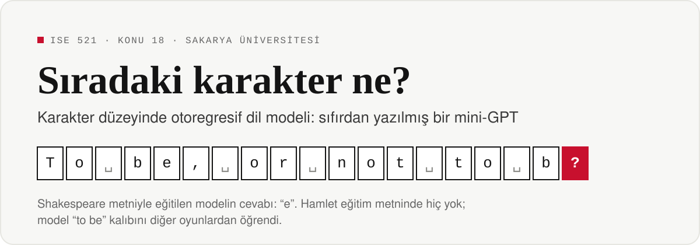
</p>

<p align="center">
  
  
  
  
</p>

**ChatGPT nasıl yazıyor?** Bu depo o sorunun cevabını, Shakespeare'in oyunlarıyla eğitilen küçük bir dil modelini sıfırdan yazarak adım adım gösteriyor. Aşağıdaki altı bölüm konunun kısa bir dersi. Her bölüm bir fikri anlatıyor ve o fikrin depodaki hangi deneyle kanıtlandığını söylüyor.

<p align="center">
  <a href="#1-dil-modeli-ne-yapar">Dil modeli ne yapar?</a> ·
  <a href="#2-metin-nasıl-parçalanır">Metin nasıl parçalanır?</a> ·
  <a href="#3-fikir-nereden-geldi">Fikir nereden geldi?</a> ·
  <a href="#4-model-nasıl-öğrenir">Model nasıl öğrenir?</a> ·
  <a href="#5-nedensel-maske-geleceği-görmeden-öğrenmek">Nedensel maske</a> ·
  <a href="#6-model-nasıl-yazar">Model nasıl yazar?</a> ·
  <a href="#kendin-dene">Kendin dene</a>
</p>

---

## 1. Dil modeli ne yapar?

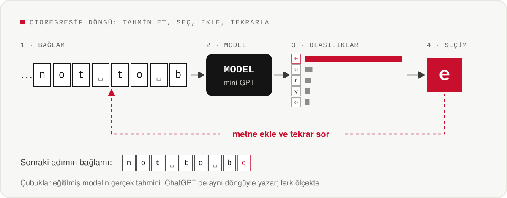

Bir dil modeli tek bir soruyu cevaplar: **sıradaki karakter ne?**

1. Önceki karakterlere bakar.
2. Alfabedeki her karaktere bir olasılık verir.
3. Birini seçer, metne ekler ve aynı soruyu yeniden sorar.

Model kendi çıktısını bir sonraki adımın girdisi yaptığı için bu yönteme **otoregresif** üretim denir. Telefon klavyesindeki kelime önerisi de ChatGPT de bu döngüyle çalışır; aradaki fark ölçektir.

## 2. Metin nasıl parçalanır?

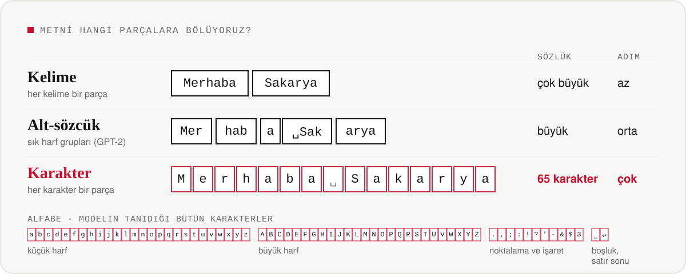

Model metni okumadan önce parçalara ayırır. Kelimeleri tek parça saymak sözlüğü çok büyütür ve hiç görülmemiş bir kelimeyle karşılaşınca model tıkanır. GPT ailesi ortadaki yolu seçer: sık geçen harf gruplarını tek parça yapar.

Bu çalışma en küçük birimi seçiyor: **tek tek karakterler**. Alfabe küçük kalıyor, bilinmeyen kelime diye bir sorun olmuyor ve modelin bütün tahmini tek bir grafikte görülebiliyor. Bedeli şu: aynı metin daha çok adım sürüyor.

> [!NOTE]
> Alfabede Türkçe harfler yok, çünkü eğitim metni İngilizce. Model alfabesinde olmayan bir karakteri hiçbir zaman yazamaz.

## 3. Fikir nereden geldi?

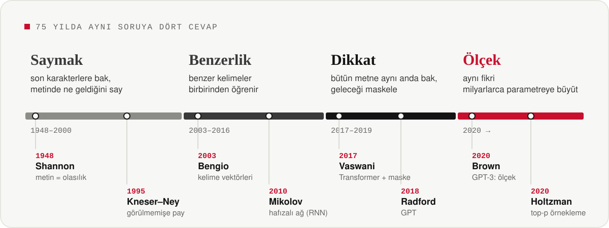

Her dönem bir öncekinin sorununu çözdü ve yeni bir sorun bıraktı:

- **Saymak:** Son birkaç karaktere bakıp metinde en sık ne geldiğini saymak basit ve hızlı. Ama bağlam uzadıkça olası bağlamların neredeyse hiçbiri metinde geçmiyor; model **görmediğini bilemiyor.**
- **Benzerlik:** Sinir ağları kelimeleri sayılarla temsil etti; benzer kelimeler birbirinden öğrenmeye başladı. Ama metni karakter karakter, **sırayla okumak zorundaydılar**; eğitim yavaştı.
- **Dikkat:** Transformer bütün metne **aynı anda** bakmayı sağladı. Bunun bir bedeli vardı: eğitimde model geleceği de görebilirdi. Çözüm **nedensel maske** oldu (5. bölüm).
- **Ölçek:** GPT ailesi aynı fikri milyarlarca parametreye büyüttü. Hedef hiç değişmedi: sıradakini tahmin etmek.

## 4. Model nasıl öğrenir?

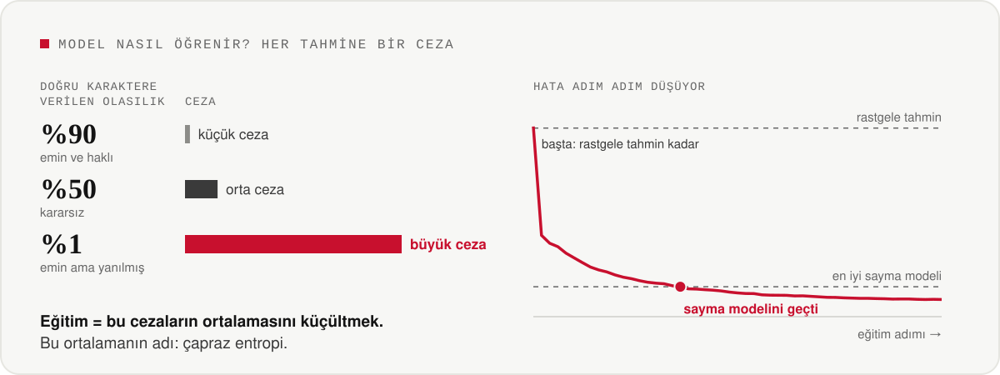

Her adımda model doğru karaktere bir olasılık verir ve buna göre ceza alır:
- **Emin ve haklıysa** ceza küçüktür.
- **Kararsızsa** ceza ortadır.
- **Emin ama yanılmışsa** ceza büyüktür.

Eğitim, bu cezaların ortalamasını küçültmekten ibarettir. Bu ortalamanın adı **çapraz entropi**.

Sağdaki eğri modelin gerçek eğitiminden geliyor. Başta model hiçbir şey bilmiyor ve rastgele tahmin kadar hata yapıyor. Kısa sürede en iyi sayma modelini geçiyor; sonunda eğri yataylaşıyor, çünkü bu küçük model öğrenebileceğinin çoğunu öğrenmiş oluyor.

> [!TIP]
> **Bu depoda:** [`experiments/exp02_train.py`](experiments/exp02_train.py) modeli eğitir ve sayma modelleriyle karşılaştırır.

## 5. Nedensel maske: geleceği görmeden öğrenmek

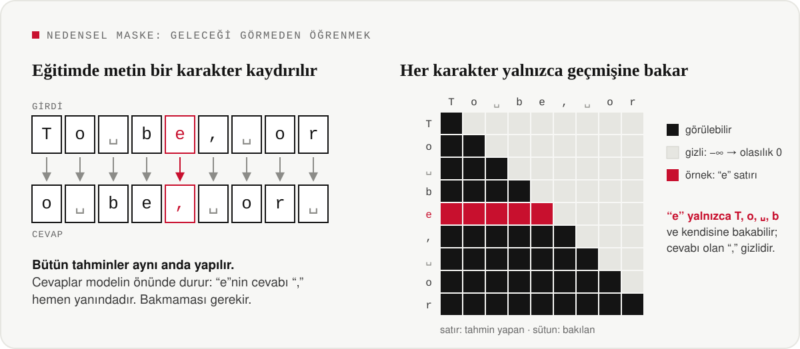

Eğitimde bir hız hilesi kullanılır: aynı metin bir karakter kaydırılarak **hem girdi hem cevap** olur ve bütün tahminler **aynı anda** yapılır. Ama cevaplar modelin önünde durduğu için bir kural gerekir: **her karakter yalnızca kendisine ve geçmişine bakabilir.**

Bu kural bir üçgen tablodur. Gelecekteki bağlantılar eksi sonsuz yapılır; olasılığa çevrilince tam olarak sıfır olurlar. Böylece model hem hızlı ve paralel eğitilir hem de kopya çekemez.

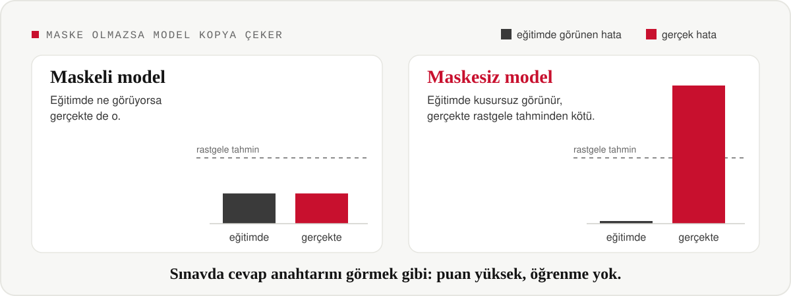

Maske kaldırılınca ne olduğunu görmek için iki model eğitildi. Maskesiz model, tahmin etmesi gereken karakteri bir sonraki konumdan okumayı kendi kendine keşfediyor. Eğitimde neredeyse kusursuz görünüyor; geleceğin gerçekten bilinmediği kullanımda ise rastgele tahminden bile kötü.

> [!IMPORTANT]
> Bu hata yalnızca eğitim hatasına bakarak **fark edilemez**. Bu yüzden depoda maske üç ayrı testle doğrulanıyor:
> - dikkat tablolarında geleceğe giden ağırlık tam sıfır mı?
> - gelecekteki bir karakter değiştirilince geçmiş tahminler değişiyor mu?
> - toplu ve karakter karakter hesap aynı sonucu veriyor mu?
>
> Bkz. [`exp01`](experiments/exp01_mask_verification.py) ve [`exp05`](experiments/exp05_chain_rule.py).

## 6. Model nasıl yazar?

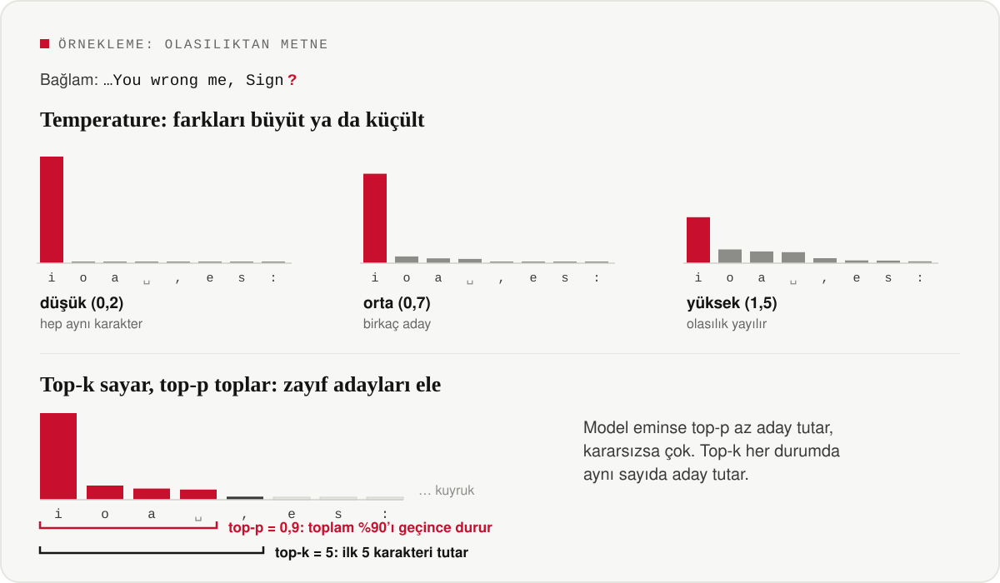

Model her adımda bir olasılık listesi verir; yazmak için bu listeden bir karakter seçmek gerekir. Seçim biçimi metni tamamen değiştirir:

- **Temperature**, olasılıklar arasındaki farkları ayarlar. Düşükken model hep en olası karaktere yapışır; yüksekken olasılık diğer karakterlere yayılır.
- **Top-k sayar:** Seçimden önce yalnızca en olası *k* karakteri tutar, gerisini atar.
- **Top-p toplar:** Olasılıkları büyükten küçüğe toplar ve toplam *p*'yi geçince durur. Model eminse az, kararsızsa çok aday tutar.

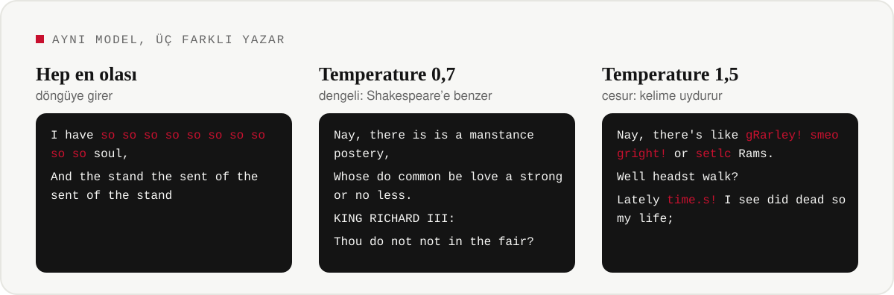

Yukarıdakiler aynı modelin üç ayarda yazdığı gerçek metinler. Hep en olası karakteri seçen ayar döngüye girip aynı kelimeyi tekrarlıyor. Fazla cesur ayar ise kelime uyduruyor. Gerçek Shakespeare metnine en yakın sonuç ortadaki dengeli ayardan geliyor.

> [!TIP]
> **Bu depoda:** [`exp03`](experiments/exp03_sampling_analysis.py) ayarların olasılıkları nasıl değiştirdiğini adım adım çizer. [`exp06`](experiments/exp06_generation_quality.py) üretilen metinleri ölçer; örneklerin tamamı [`results/exp06_samples.md`](results/exp06_samples.md) dosyasında.

---

## Bu depodaki yedi deney

| | Sorduğu soru | Betik |
|:---:|---|---|
| **1** | Maske geleceği gerçekten gizliyor mu? Maske olmazsa ne olur? | [`exp01_mask_verification.py`](experiments/exp01_mask_verification.py) |
| **2** | Model öğreniyor mu? Saymaktan daha mı iyi? | [`exp02_train.py`](experiments/exp02_train.py) |
| **3** | Temperature, top-k ve top-p olasılıkları nasıl değiştiriyor? | [`exp03_sampling_analysis.py`](experiments/exp03_sampling_analysis.py) |
| **4** | Temperature'ın etkisi matematikteki formüllerle uyuşuyor mu? | [`exp04_softmax_temperature.py`](experiments/exp04_softmax_temperature.py) |
| **5** | Toplu hesap ile karakter karakter hesap aynı sonucu veriyor mu? | [`exp05_chain_rule.py`](experiments/exp05_chain_rule.py) |
| **6** | Ayarlar üretilen metnin kalitesini nasıl etkiliyor? | [`exp06_generation_quality.py`](experiments/exp06_generation_quality.py) |
| **7** | Hazır kütüphanelerle aynı sonucu veriyor mu? Hangi hileler gerekli? | [`exp07_library_comparison.py`](experiments/exp07_library_comparison.py) |

**Deneylerin ürettiği şekillerden bazıları** (büyütmek için tıklayın):

<table>
  <tr>
    <td width="50%" align="center"><a href="figures/fig01_mask_heatmaps.png">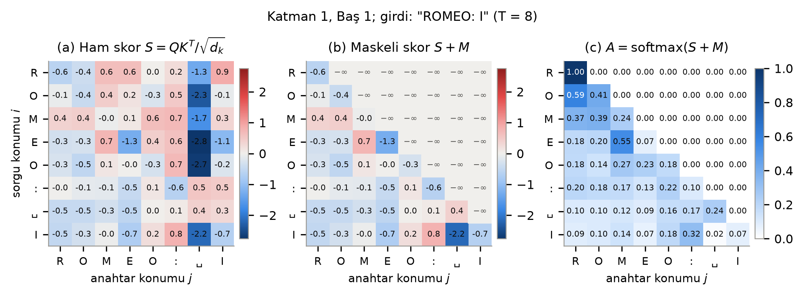</a><br><sub><b>Maske:</b> dikkat puanları, maske ve sonuç</sub></td>
    <td width="50%" align="center"><a href="figures/fig01_leak_training.png">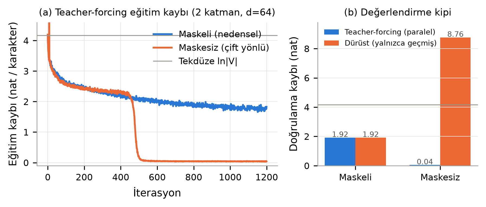</a><br><sub><b>Kopya:</b> maskesiz modelin eğitimi</sub></td>
  </tr>
  <tr>
    <td width="50%" align="center"><a href="figures/fig03_stepwise_bars.png">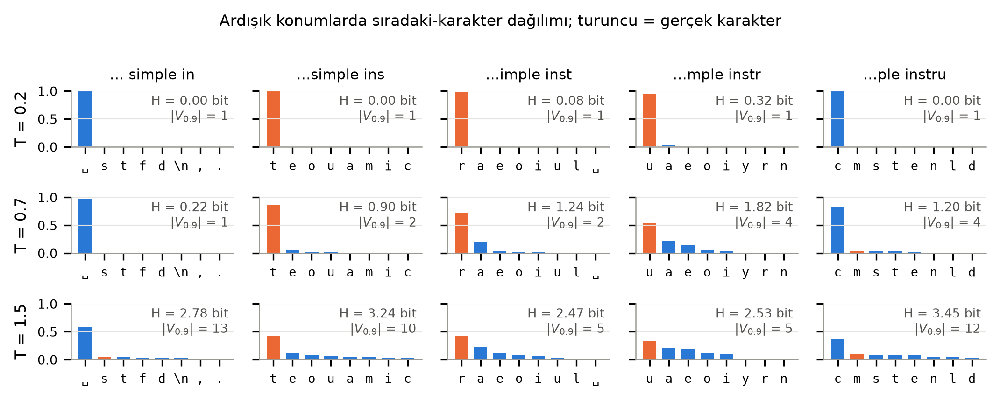</a><br><sub><b>Temperature:</b> ardışık konumlarda olasılıklar</sub></td>
    <td width="50%" align="center"><a href="figures/fig03_cumulative_entropy.png">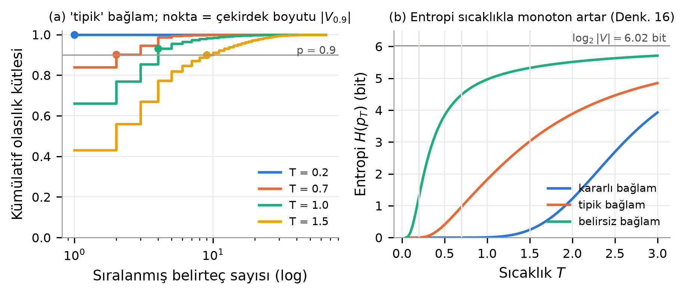</a><br><sub><b>Top-p:</b> birikimli olasılık ve belirsizlik</sub></td>
  </tr>
  <tr>
    <td width="50%" align="center"><a href="figures/fig_ngram_vs_neural.png">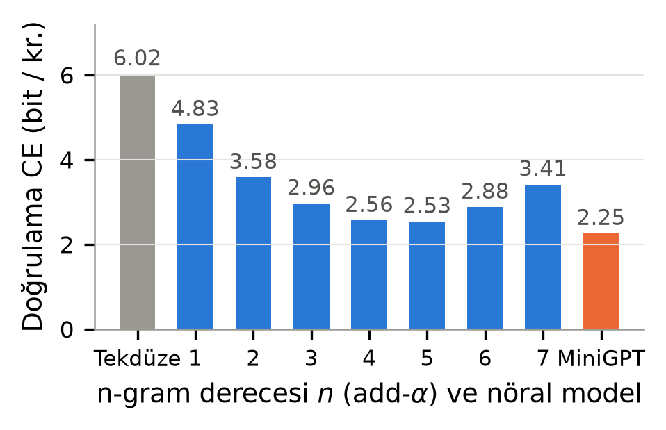</a><br><sub><b>Karşılaştırma:</b> sayma modelleri ve mini-GPT</sub></td>
    <td width="50%" align="center"><a href="figures/fig_loss_curve.png">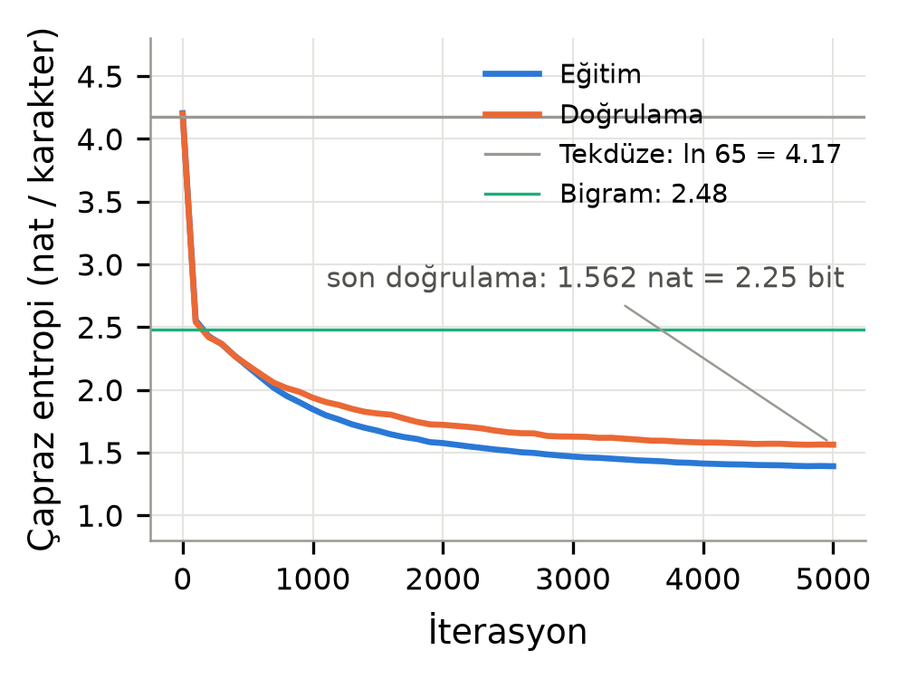</a><br><sub><b>Eğitim:</b> hata adım adım düşüyor</sub></td>
  </tr>
</table>

## Kendin dene

```bash
git clone https://github.com/Yunuskupucu/Causal-LLM.git && cd Causal-LLM

uv venv --python 3.12 .venv                                    # uv yoksa: brew install uv
uv pip install --python .venv/bin/python -r requirements.txt

.venv/bin/python run_all.py          # bütün deneyler ve şekiller, yalnızca işlemciyle
.venv/bin/python run_all.py exp03    # tek bir deney (önce model eğitilmiş olmalı)
```

Tek komut modeli eğitir, yedi deneyi sırayla çalıştırır, sonuçları yazar ve rapordaki zaman çizelgesini çizer. Sıradan bir dizüstü bilgisayarda 10–16 dakika sürer.
- **Şekiller:** `figures/` klasörüne
- **Sayısal sonuçlar:** `results/` klasörüne
- **Üretilen metinler:** `results/exp06_samples.md` dosyasına

Bütün rastgelelik sabit; kodu kim çalıştırırsa çalıştırsın aynı modeli ve aynı sonuçları elde eder.

<details>
<summary><b>Model ve eğitim ayarları</b></summary>

| | |
|---|---|
| Mimari | 4 Transformer katmanı, 4 dikkat başı, 128 boyutlu vektörler, 816 bin parametre |
| Bağlam | 128 karakter |
| Veri | Tiny Shakespeare, 1,1 milyon karakter; ilk %90 eğitim, son %10 doğrulama |
| Eğitim | 5000 adım, AdamW, ısınma ve kosinüs öğrenme oranı, yalnızca işlemci |
| Sonuç | doğrulamada 2,25 bit/karakter (en iyi sayma modeli 2,53) |

Bütün ayarlar [`config.py`](config.py) içinde. Rapordaki her denklemin hangi kod satırına karşılık geldiği [`EQUATIONS.md`](EQUATIONS.md) dosyasında.

</details>

<details>
<summary><b>Yeniden üretilebilirlik</b></summary>

- Tek tohum (`SEED = 521`, ders kodu) ve `torch.use_deterministic_algorithms(True)`.
- Veri seçimi, değerlendirme ve üretim için ayrı rastgele sayı üreteçleri.
- Eğitim yalnızca işlemcide yapılır; ekran kartı (GPU/MPS) bit düzeyinde eşitlik garanti etmez.
- Süre ölçümleri ayrı dosyalarda tutulur; diğer sonuçları etkilemez.

Depo başka bir bilgisayarda GitHub'dan temiz olarak indirilip baştan çalıştırıldı. Sonuç:
- Eğitilen model aynı md5 değerini verdi (`30d4cfe1f28ce3db4d7509f3bff1b1de`).
- Süre ölçümleri dışındaki bütün sonuç dosyaları bayt bayt, şekiller piksel piksel aynı çıktı.

</details>

<details>
<summary><b>Dizin yapısı</b></summary>

```text
.
├── run_all.py            tek komut: bütün deneyler
├── config.py             bütün ayarlar
├── requirements.txt      sabit paket sürümleri
├── EQUATIONS.md          rapor denklemi ↔ kod haritası
├── data/                 Tiny Shakespeare metni
├── src/                  modelin kendisi
│   ├── tokenizer.py      karakterleri sayılara çevirir
│   ├── data.py           eğitim için girdi ve kaydırılmış cevap
│   ├── model.py          nedensel maske, dikkat, MiniGPT
│   ├── sampling.py       temperature, top-k, top-p
│   ├── ngram.py          karşılaştırma için sayma modeli
│   └── utils.py          tohum, grafik stili, kayıt
├── experiments/          yedi deney + zaman çizelgesi (fig00_timeline.py)
├── figures/              deneylerin şekilleri (PDF + PNG)
├── results/              sayısal sonuçlar ve üretilen metinler
└── docs/gorseller/       bu README'nin görselleri ve onları üreten betik
```

</details>

<details>
<summary><b>Sorun giderme</b></summary>

| Belirti | Çözüm |
|---|---|
| `.venv/bin/python` bulunamıyor | Ortamı yeniden kurun: `uv venv --clear --python 3.12 .venv` ve ardından `uv pip install --python .venv/bin/python -r requirements.txt` |
| macOS'ta "libtorch_global_deps.dylib açılmadı" uyarısı | `.venv` başka bir bilgisayardan kopyalanmış. "Bitti"ye basın, `.venv`'i silip yeniden kurun. Projeyi taşırken `.venv`'i taşımayın. |
| Sonuçlar farklı çıktı | Ekran kartı değil işlemci kullanıldığından emin olun (`config.py`: `DEVICE = "cpu"`). |

</details>

<details>
<summary><b>Kaynaklar</b></summary>

- C. E. Shannon, "A Mathematical Theory of Communication," 1948; "Prediction and Entropy of Printed English," 1951.
- Y. Bengio vd., "A Neural Probabilistic Language Model," *JMLR*, 2003.
- I. Sutskever, J. Martens, G. Hinton, "Generating Text with Recurrent Neural Networks," *ICML*, 2011.
- A. Vaswani vd., "Attention Is All You Need," *NeurIPS*, 2017.
- A. Radford vd., GPT (2018) ve GPT-2 (2019) teknik raporları.
- A. Fan vd., "Hierarchical Neural Story Generation" (top-k), *ACL*, 2018.
- A. Holtzman vd., "The Curious Case of Neural Text Degeneration" (top-p), *ICLR*, 2020.
- A. Karpathy, nanoGPT, 2022. Bu deponun modeli nanoGPT'nin sadeleştirilmiş, her adımı açıkça yazılmış bir yeniden yazımıdır.

Metin: Tiny Shakespeare (kamu malı; A. Karpathy'nin char-rnn deposundan). Yöntemin tarihsel gelişimi ve tam kaynakça teknik raporda.

</details>

<details>
<summary><b>English summary</b></summary>

A from-scratch, character-level GPT trained on Shakespeare that walks through the three ideas behind every causal language model: learning by next-character prediction, the causal attention mask, and sampling (temperature, top-k, top-p). Seven controlled experiments prove each mechanism — including a model trained without the mask, which learns to "copy" the answer and looks perfect in training but fails completely at inference. One command (`python run_all.py`) reproduces every figure and number bit-for-bit on a CPU.

</details>

<br>
<p align="center"><sub>ISE 521 Yapay Zekâda Öğrenme Yöntemleri · Konu 18 · Yunus Emre Küpücü · Sakarya Üniversitesi</sub></p>
