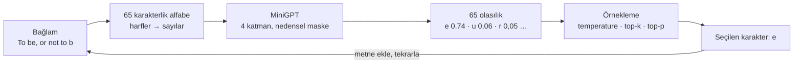

<div align="center">

# Sıradaki karakter ne?

### Karakter düzeyinde otoregresif (causal) dil modeli: sıfırdan yazılmış bir mini-GPT ve yedi deneyle mekanizma kanıtı

**ISE 521 Yapay Zekâda Öğrenme Yöntemleri · Konu 18 · Sakarya Üniversitesi**


</div>

> ChatGPT dahil bütün büyük dil modelleri aynı soruyu cevaplar: **sıradaki parça ne?** Bu depo o sorunun arkasındaki üç mekanizmayı (**zincir kuralıyla öğrenme**, **nedensel maske** ve **örnekleme**) 816 bin parametrelik küçük bir GPT'yi hiçbir hazır dikkat ya da örnekleme soyutlaması kullanmadan yazarak açığa çıkarır. Her iddia, kendi modelimden ölçülmüş bir sayıyla kanıtlanır.

<p align="center">
  
</p>
<p align="center"><i><b>Maske olmazsa model kopya çeker.</b> Maskesiz model yaklaşık 450. adımda cevabı bir sonraki konumdan okumayı keşfeder:<br>eğitimde hatası 0,04 nat'a iner ama gerçek kullanımda 8,76 nat'a çıkar; rastgele tahmin bile 4,17 nat (Deney 1).</i></p>

---

## Bir bakışta

| | |
|---|---|
| **Model** | 4 Transformer katmanı · 4 dikkat başı · d = 128 · **816.000 parametre** |
| **Veri** | Tiny Shakespeare · **1.115.394 karakter** · 65 karakterlik alfabe (26 küçük ve 26 büyük harf, boşluk, satır sonu, 11 işaret) |
| **Sonuç** | doğrulama **2,25 bit/karakter**; en iyi sayma modeli (5-gram) 2,53 |
| **Maskenin kanıtı** | paralel ve sıralı hesap arasındaki fark **0,000015**; maskesiz modelde **103** |
| **Süre** | `run_all.py` ile 7 deney ve 13 şekil: Apple M4'te ~10 dk, M2'de ~16 dk (yalnızca CPU) |
| **Yeniden üretim** | `model.pt` md5 `30d4cfe1…` · başka bir bilgisayarda, temiz kopyada bütün sonuçlar bayt bayt aynı |

## Nasıl çalışıyor?



Şemadaki olasılıklar eğitilmiş modelin gerçek çıktısıdır. Hamlet eğitim metninde hiç geçmediği hâlde model "to be" kalıbını diğer oyunlardan öğrenmiştir.

**1. Zincir kuralı: metni karakter karakter kurmak.** Bir metnin olasılığı, her adımdaki "sıradaki karakter" tahminlerinin çarpımıdır. Model, doğru karaktere verdiği olasılığın eksi logaritmasını, yani **çapraz entropiyi** küçültmeyi öğrenir. Doğru karaktere %90 verirse ceza 0,1; %1 verirse 4,6 olur.

**2. Nedensel maske: geleceği görmeden öğrenmek.** Eğitimde aynı metin bir karakter kaydırılarak hem girdi hem cevap olur ve 128 tahmin **aynı anda** yapılır:

```text
girdi : T o ␣ b e , ␣ o r
cevap : o ␣ b e , ␣ o r ␣
```

Cevaplar modelin önünde durduğu için her konumun yalnızca kendisine ve geçmişine bakması gerekir. Dikkat puanlarının üst üçgenine −∞ eklenir; softmax'tan sonra bu ağırlıklar **tam olarak 0** olur. Maskesiz model ise cevabı bir sonraki konumdan okur (yukarıdaki şekil).

**3. Örnekleme: olasılıktan metne.** Model 65 karakterin hepsine bir olasılık verir; yazmak için birini seçmek gerekir. **Temperature** olasılık farklarını büyütür ya da küçültür. **Top-k** en olası k karakteri tutar ("sayar"). **Top-p** olasılıkları büyükten küçüğe toplar ve toplam p'yi geçince durur ("toplar"). Aynı model, bu ayarlara göre tekrarlayan, dengeli ya da kelime uyduran metin yazar.

## Hızlı başlangıç

```bash
git clone https://github.com/Yunuskupucu/Causal-LLM.git
cd Causal-LLM

# Ortam (uv önerilir; yoksa: brew install uv)
uv venv --python 3.12 .venv
uv pip install --python .venv/bin/python -r requirements.txt

# Tek komut: 7 deney, 13 şekil, bütün sayısal sonuçlar
.venv/bin/python run_all.py

# Yalnızca bir deney (önce results/model.pt oluşmuş olmalı)
.venv/bin/python run_all.py exp03
```

Klasik `venv` + `pip` de çalışır: `python3.12 -m venv .venv && .venv/bin/pip install -r requirements.txt`. Külliyat (`data/tinyshakespeare.txt`) depoda hazır; ağ erişimi gerekmez.

**Çıktılar:** `figures/` (her şekil PDF ve 300 DPI PNG), `results/*.json` (bütün sayılar), `results/exp06_samples.md` (üretilen metinler), `results/model.pt` (eğitilmiş model).

## Yedi deney

| Deney | Sorduğu soru | Ölçülen sonuç | Şekil |
|---|---|---|---|
| **01** maske | Maske geleceği gerçekten gizliyor mu? | 128 dikkat matrisinin hepsinde üst üçgen tam 0. Gelecekteki karakteri değiştirmek geçmiş tahminleri hiç etkilemiyor; maskesiz modelde etki 20,5'e varıyor. Maskesiz eğitilen model eğitimde 0,04 nat, gerçekte 8,76 nat. | `fig01_*` |
| **02** eğitim | Model öğreniyor mu, saymaktan iyi mi? | 2,25 bit/karakter; en iyi n-gram 2,53. 6- ve 7-gram veri yetmediği için kötüleşiyor. Model 1800. adımda 5-gram'ı geçiyor. | `fig_loss_curve`, `fig_ngram_vs_neural` |
| **03** örnekleme | Temperature, top-k ve top-p dağılımı nasıl değiştirir? | Ortalama entropi T = 0,2'de 0,43 bit, T = 1,5'te 2,87 bit. Top-p (0,9) kararlı bağlamda 1, belirsiz bağlamda 29 aday tutuyor; top-k her durumda 5. | `fig03_*` |
| **04** türevler | Temperature'ın softmax türevine etkisi formülle uyuşuyor mu? | dH/dT = Var(z)/T³ her yerde pozitif (en küçük 0,109): temperature arttıkça belirsizlik hiç azalmıyor. Analitik türev sayısal türevle uyumlu. | `fig04_temperature_derivatives` |
| **05** zincir kuralı | Paralel hesap, harf harf hesapla aynı mı? | Maskeli modelde fark 0,000015 (kayan nokta hassasiyeti), maskesiz modelde 103. | `fig05_chain_rule` |
| **06** metin kalitesi | Ayarlar üretilen metni nasıl etkiler? | Hep en olası karakter: %87 tekrar, döngü. T = 0,7: %14 tekrar, %94 geçerli kelime (gerçek metin: %16 / %94). T = 1,5: geçerli kelime %59. | `fig06_generation_quality` |
| **07** kütüphaneler | Hazır kütüphanelerle aynı sonucu veriyor mu? | PyTorch SDPA ile fark ≤ 7,7·10⁻⁷. Dikkat matrisi T = 2048'de 64 MB (T² büyüme). Tamamen maskeli satırda −∞ NaN verir, `finfo.min` vermez. Hugging Face top-p ile 2.000 denemede 0 fark. | `fig07_attention_timing` |

## Öne çıkan sonuçlar

### Saymaktan benzerliğe


Son birkaç karaktere bakıp "kitapta ne geldiğini sayan" n-gram modeli, bağlam uzadıkça önce iyileşir, sonra kötüleşir. 65 karakterlik alfabede 6 karakterlik bağlamın 75 milyar olası hâli var; eğitim metninde bunların yalnızca 264 bini geçiyor.

Mini-GPT 128 karakterlik bağlamı **saymak yerine benzerlikten öğrenerek** kullanır ve en iyi n-gram'ı geçer. Gri çubuk, 65 karakterin eşit olasılıklı olduğu rastgele tahmindir.

<br clear="right">

### Maske: üst üçgen tam sıfır

<p align="center"></p>

Girdi `ROMEO: I`. Soldan sağa: ham dikkat puanları, geleceğe −∞ eklenmiş puanlar ve softmax sonrası ağırlıklar. Her satır yalnızca kendisine ve soluna bakabilir. Eğitilmiş modelin 128 dikkat matrisinde gri bölgenin en büyük değeri **tam 0,0**.

### Temperature ve top-p, adım adım

<p align="center"></p>

Aynı beş ardışık konumda üç temperature değeri; turuncu çubuk gerçek karakter, H entropi, |V₀.₉| top-p'nin tuttuğu aday sayısı. T = 0,2'de top-p her konumda tek aday tutar; T = 1,5'te bu sayı konuma göre 5 ile 13 arasına çıkar.

### Aynı model, üç farklı yazar

| Hep en olası karakter (T → 0) | T = 0,7 | T = 1,5 |
|---|---|---|
| `I have so so so so so so so so so so soul,`<br>`And the stand the sent of the sent of the stand` | `Nay, there is is a manstance postery,`<br>`Whose do common be love a strong or no less.`<br>`KING RICHARD III:`<br>`Thou do not not in the fair?` | `Nay, there's like gRarley! smeo gright! or setlc Rams.`<br>`Well headst walk?`<br>`Lately time.s! I see did dead so my life;` |
| %87 tekrar · %100 geçerli kelime | %14 tekrar · %94 geçerli kelime | %3 tekrar · %59 geçerli kelime |

Soldaki ayar döngüye girer; sağdaki kelime uydurur. Gerçek Shakespeare metnine (%16 tekrar, %94 geçerli kelime) en yakın ayarlar temperature 0,7 ve top-p 0,9'dur. Bu, Holtzman vd.'nin (2020) top-p'yi önerirken anlattığı iki sorunun küçük ölçekteki karşılığıdır.

## Yeniden üretilebilirlik

- **Tek tohum:** `config.SEED = 521` (ders kodu). `random`, `numpy` ve `torch` bu tohumla sabitlenir; `torch.use_deterministic_algorithms(True)` açıktır.
- **Ayrı üreteçler:** Mini-yığın seçimi, değerlendirme ve üretim için ayrı `torch.Generator` nesneleri kullanılır.
- **Yalnızca CPU:** GPU ve MPS bit düzeyinde eşitlik garanti etmez.
- **Süre ölçümleri ayrı dosyalarda:** `train_timing.json` ve `exp07_timing.json`; diğer sonuçları etkilemez.

**Doğrulandı:** Depo başka bir bilgisayarda (Apple M2) GitHub'dan temiz olarak indirildi, ortam `requirements.txt`'ten sıfırdan kuruldu ve `run_all.py` çalıştırıldı (940 sn). Sonuçlar:
- `model.pt` md5 değeri `30d4cfe1f28ce3db4d7509f3bff1b1de` ile birebir aynı.
- 10 sonuç JSON'unun 8'i bayt bayt aynı; farklı olan 2'si yalnızca süre ölçümü.
- 13 şeklin 12'si piksel piksel aynı; farklı olan, süre grafiği (`fig07`).

`model.pt` depoda tutulmaz (`.gitignore`); `run_all.py` onu aynı md5 değeriyle yeniden üretir.

## Model ve eğitim ayarları

| Ayar | Değer |
|---|---|
| Bağlam penceresi | 128 karakter |
| Katman / dikkat başı / boyut | 4 / 4 / 128 (baş başına 32) |
| Gömme | karakter + konum; çıkış katmanı gömme ağırlığını paylaşır |
| Blok yapısı | ön-LayerNorm, GELU, dropout 0,1 |
| Optimizasyon | AdamW, β = (0,9; 0,95), ağırlık sönümü 0,1, gradyan kırpma 1,0 |
| Öğrenme oranı | 100 adım ısınma, sonra kosinüs; en yüksek 1e-3 |
| Mini-yığın | 32 × 128 karakter · 5000 adım (~20,5 milyon karakter) |
| Veri bölmesi | ilk %90 eğitim (1.003.854), son %10 doğrulama (111.540) |
| Doğrulama hatası | 1,562 nat = 2,254 bit/karakter, perplexity 4,77 (20 yığınlık kestirim); bütün doğrulama metninde 1,591 nat |

Bütün hiperparametreler `config.py`'de; her kod bloğunun rapordaki hangi denkleme karşılık geldiği [`EQUATIONS.md`](EQUATIONS.md)'de (20 denklem).

<details>
<summary><b>Dizin yapısı</b></summary>

```text
.
├── run_all.py                  tek komut: 7 deney sırayla
├── config.py                   bütün hiperparametreler, SEED = 521
├── requirements.txt            sabit sürümler
├── EQUATIONS.md                rapor denklemi ↔ kod satırı haritası
├── data/tinyshakespeare.txt    külliyat (1.115.394 karakter)
├── src/
│   ├── tokenizer.py            karakter düzeyi belirteçleyici (65 karakter)
│   ├── data.py                 bölme ve (girdi, bir karakter kaydırılmış cevap) mini-yığınları
│   ├── model.py                causal_mask, CausalSelfAttention, MiniGPT
│   ├── sampling.py             temperature, top-k, top-p, entropi ve türevler
│   ├── ngram.py                add-α n-gram taban çizgisi
│   └── utils.py                tohum, grafik stili, kayıt
├── experiments/
│   ├── exp01_mask_verification.py      maske ve sızıntı testleri
│   ├── exp02_train.py                  eğitim ve n-gram kıyası
│   ├── exp03_sampling_analysis.py      temperature, top-k, top-p
│   ├── exp04_softmax_temperature.py    softmax türevleri
│   ├── exp05_chain_rule.py             paralel = sıralı
│   ├── exp06_generation_quality.py     metin kalitesi
│   └── exp07_library_comparison.py     SDPA, logsumexp, Hugging Face
├── figures/                    13 şekil (PDF + PNG)
└── results/                    JSON sonuçlar, günlükler, üretilen metinler
```

Toplam yaklaşık 2.100 satır Python. Dikkat, maske ve örnekleme adımlarının hepsi bu depoda açıkça kodlanmıştır.

</details>

<details>
<summary><b>Sorun giderme</b></summary>

| Belirti | Çözüm |
|---|---|
| `no such file or directory: .venv/bin/python` | Ortamı yeniden kurun: `uv venv --clear --python 3.12 .venv && uv pip install --python .venv/bin/python -r requirements.txt` |
| macOS: "libtorch_global_deps.dylib açılmadı" uyarısı | `.venv` başka bir bilgisayardan kopyalanmış (ör. AirDrop). "Bitti"ye basın, `.venv`'i silip yukarıdaki komutla yeniden kurun. Projeyi taşırken `.venv`'i taşımayın. |
| Sonuçlar farklı çıktı | CPU kullanıldığından emin olun (`config.DEVICE = "cpu"`). `md5 results/model.pt` değeri `30d4cfe1f28ce3db4d7509f3bff1b1de` olmalı. |
| Eğitim uzun sürdü | Normal; süre donanıma bağlı (M4: 405 sn, M2: 845 sn). Sonuçlar değişmez. |

</details>

## Kaynaklar

Yöntemin geçmişten bugüne gelişimi ve tam kaynakça teknik raporda. Bu depoda doğrudan kullanılanlar:

- C. E. Shannon, "A Mathematical Theory of Communication," 1948; "Prediction and Entropy of Printed English," 1951.
- Y. Bengio, R. Ducharme, P. Vincent, C. Jauvin, "A Neural Probabilistic Language Model," *JMLR*, 2003.
- I. Sutskever, J. Martens, G. Hinton, "Generating Text with Recurrent Neural Networks," *ICML*, 2011.
- A. Vaswani vd., "Attention Is All You Need," *NeurIPS*, 2017.
- A. Radford vd., "Improving Language Understanding by Generative Pre-Training," 2018; "Language Models are Unsupervised Multitask Learners," 2019.
- A. Fan, M. Lewis, Y. Dauphin, "Hierarchical Neural Story Generation" (top-k), *ACL*, 2018.
- A. Holtzman vd., "The Curious Case of Neural Text Degeneration" (top-p), *ICLR*, 2020.
- A. Karpathy, nanoGPT, GitHub, 2022. Bu deponun model tasarımı nanoGPT'nin sadeleştirilmiş, açık matematikli bir yeniden yazımıdır.

Külliyat: Tiny Shakespeare (kamu malı; A. Karpathy'nin char-rnn deposundan).

---

<details>
<summary><b>English summary</b></summary>

A from-scratch, character-level GPT (816k parameters, 4 layers, 4 heads, d = 128) trained on Tiny Shakespeare, built to expose the three mechanisms behind every causal language model: chain-rule training with cross-entropy, the causal attention mask, and output sampling (temperature, top-k, top-p). Seven controlled experiments verify each mechanism. The masked model reaches 2.25 bits/char (best n-gram: 2.53); a model trained without the mask "cheats" (0.04 nats in training, 8.76 nats at inference); parallel and sequential log-likelihoods agree to 1.5·10⁻⁵. `python run_all.py` regenerates every figure and number bit-for-bit on CPU (verified on a second machine from a clean clone).

</details>

<p align="center"><sub>ISE 521 · Konu 18 · Yunus Emre Küpücü · Sakarya Üniversitesi</sub></p>
